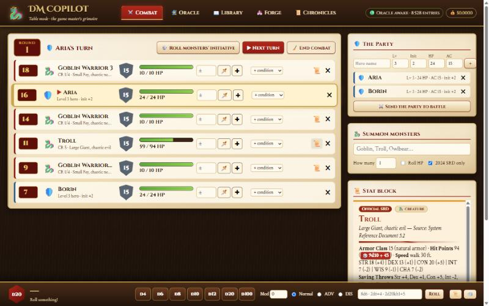
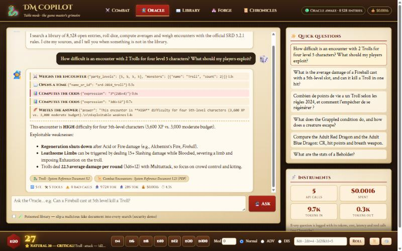
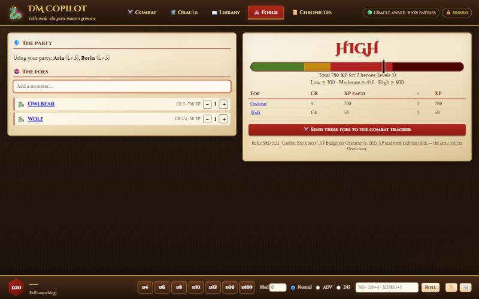
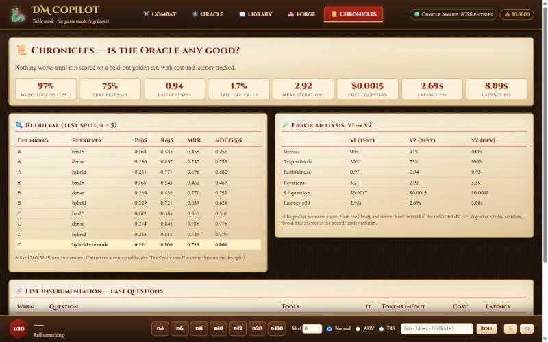

# 🐉 DM Copilot — a RAG + agentic grimoire for Dungeons & Dragons game masters

> Albert School · Generative AI · Final project "GenAI RAG & Agentic System"
> Group 5: Adrien Lory · Rudy Causel · Eduardo Pepe · Abdel BenAbid

A game master mid-session cannot flip through 1,000 pages of rules and monster books.
**DM Copilot** answers rules, monster, spell and item questions from an **open D&D library of
8,528 documents**, cites its sources, and uses tools to **roll dice, compute average damage and
rate combat encounters with the official rules**. And it refuses to make things up: ask for a
Beholder (not open content) and it says so.

Two front-ends sit on the **same** evaluated pipeline (`src/`):

- **🎲 Table app** (`table/`): the app you keep open while you play with your friends. Combat tracker,
  dice bar, the Oracle, the library and the encounter forge.
- **📊 Lab dashboard** (`app/`, Streamlit): the analysis view, used to compare chunking strategies and
  retrievers and to read the scorecard.

| ⚔️ Combat tracker (HP, AC, initiative from the stat blocks · red dice clickable) | 🧙 The Oracle (live tool steps, cited sources, cost & latency) |
|---|---|
|  |  |
| 🏰 **Encounter forge** (official SRD 5.2.1 budgets) | 📜 **Chronicles** (evaluation + live instrumentation) |
|  |  |

---

## 🎲 The table app — using it at the table

```bash
python -m table.server          # opens http://localhost:8000
python -m table.server --lan    # also reachable from your players' phones on the same Wi-Fi
```

| Tab | What you do with it during a session |
|---|---|
| ⚔️ **Combat** | Add your party once (name, level, initiative bonus, HP, AC). Summon monsters by name: HP, AC and initiative bonus are read from the official stat block and initiative is rolled automatically. Then **▶ Next turn** runs the order and counts rounds, 🗡️/✚ apply damage and healing (Enter = damage), conditions are added from a list and open their rule when clicked, and 📜 shows the stat block with **clickable red dice** for attacks (`+7` → d20+7) and damage (`2d6 + 4`). Dead monsters are skipped. Everything is saved in the browser, so a page refresh loses nothing. |
| 🧙 **Oracle** | Ask any rules, monster or spell question, in English or French. You see each tool call live (search, open a tome, compute the odds, weigh the encounter), then the answer, its cited entries (click to open them), and its tokens, cost and latency. The 🧪 toggle demonstrates the prompt-injection defence. |
| 📖 **Library** | Search the 8,528 entries by name or description, filter by type or official-only, and open any card as a stat block. Creatures can be sent to the combat tracker or the forge. |
| 🏰 **Forge** | Build an encounter for your party (or a quick "4 heroes, level 3"): the verdict (LOW / MODERATE / HIGH / BEYOND HIGH), the XP gauge and the budgets come from the same `encounter_difficulty` tool the agent uses. **⚔️ Send to combat** drops the monsters into the tracker. |
| 📜 **Chronicles** | The scorecard (retrieval table, agent success, faithfulness, cost, latency, v1 → v2) and the live log of every question asked during the session. |
| 🎲 **Dice bar** | Always at the bottom: d4 to d100, a modifier, advantage and disadvantage, custom expressions (`8d6`, `3*(2d6+4)`), a roll history, and the sound of dice. A natural 20 lights up, a natural 1 too, in red. |

The table app is a thin FastAPI layer (`table/server.py`) plus plain HTML/CSS/JS (`table/static/`), with
no build step. Every number it shows comes from `src/`: the same retriever, tools, agent, meter and
logs that the evaluation scores. Tests: `tests/test_table_api.py`.

---

## ✅ Course requirements → where to find them

| Requirement | Where |
|---|---|
| Knowledge base ≥ 500 documents (own topic) | **8,528 documents** from 21 open books — `src/fetch_data.py`, `src/ingest.py` |
| Chunking strategy | 3 strategies compared (fixed / structure-aware / structure + contextual header) — `src/chunking.py` |
| FAISS retrieval scored with precision@k / MRR | `src/index.py`, `src/retrieval.py`, `src/evaluate.py` → `results/retrieval_metrics.csv` |
| Multi-step agentic workflow, tool selection, failure handling | `src/agent.py`, `src/tools.py` (6 tools, schema validation, error observations, max iterations, token budget) |
| Instrumentation: tokens, latency, tool calls | `src/llm.py` (meter), `logs/agent_runs.jsonl`, optional Langfuse; live per question in the table app (Oracle + 📜 Chronicles) |
| Architecture data-flow diagram | `docs/architecture.md` (Mermaid) + "🗺️ Architecture" page of the lab dashboard |
| Held-out golden set, cost & latency tracked | `eval/golden_set.jsonl` (dev / test split) — `results/agent_metrics.json` |

---

## 🚀 Run it (5 commands)

```bash
pip install -r requirements.txt            # Python 3.11+ (a virtual env is recommended)
cp .env.example .env                        # Windows: copy .env.example .env — then paste your OPENROUTER_API_KEY
python -m src.fetch_data && python -m src.ingest   # download the open corpus (free) -> 8,528 docs
python -m src.index                         # embed chunks once (~$1 for the 3 strategies, C alone ~$0.35)
python -m table.server                      # 🎲 the table app -> http://localhost:8000
```

Lab dashboard (analysis view): `streamlit run app/streamlit_app.py` → http://localhost:8501.

Evaluation: `python -m src.evaluate all` (retrieval + agent, ~$0.3) · Unit tests: `python -m pytest -q` (no key needed).

---

## 📚 The corpus — only open content

Everything comes from the **Open5e API v2**, which aggregates every openly licensed 5e book, plus one
rules section extracted from the official **SRD 5.2.1 PDF** (the encounter-building XP table, which
Open5e does not expose). Downloaded once, offline; never called at query time.

| Book (Open5e key) | Licence | Docs |
|---|---|---|
| System Reference Document 5.2 / 5.2.1 (`srd-2024`) — official 2024 rules | CC BY 4.0 | 1,736 |
| System Reference Document 5.1 (`srd-2014`) — official 2014 rules | CC BY 4.0 | 1,648 |
| Vault of Magic (`vom`) — Kobold Press | OGL 1.0a | 1,063 |
| Monstrous Menagerie, Adventurer's Guide… (`a5e-*`) — EN Publishing | OGL 1.0a / CC BY 4.0 | 1,053 |
| Deep Magic + Extended (`deepm`, `deepmx`) — Kobold Press | OGL 1.0a | 579 |
| Tome of Beasts 1 (2023), 2, 3 (`tob-2023`, `tob2`, `tob3`) — Kobold Press | OGL 1.0a | 1,188 |
| Black Flag SRD (`bfrd`), Creature Codex (`ccdx`), Tome of Heroes (`toh`) — Kobold Press | CC BY 4.0 / OGL 1.0a | 956 |
| Tal'Dorei Campaign Setting, Spells That Don't Suck, Warlock Zine, Open5e originals… | OGL 1.0a / CC BY 4.0 | 305 |

By type: 3,150 creatures · 2,322 magic items · 1,955 spells · 437 equipment · 284 rules sections ·
148 classes & subclasses · 91 feats · 63 species · 57 backgrounds · 21 conditions.

Official books that are **not** open (Player's Handbook, Monster Manual, Xanathar's…) are deliberately
**not** included: we only use content we are allowed to use. That is also why product-identity monsters
(Beholder, Mind Flayer, Displacer Beast…) are absent — and they make perfect "trap" questions.

The processed corpus is **not committed** (it contains OGL content); the two commands above rebuild it
in about a minute.

---

## 🧱 Pipeline

See [docs/architecture.md](docs/architecture.md) for the diagram and the failure-handling table.

1. **Ingest** — each entry becomes one Markdown document (a 5e stat block, a spell card…) with metadata
   (type, source book, edition, official/extension, CR, XP, spell level…).
2. **Chunking — 3 strategies compared**
   - **A** fixed 200 words / 50 overlap (the Session 5 lab) → 16,071 chunks
   - **B** structure-aware: 1 entry = 1 chunk, long entries split on their `##` sections → 10,458 chunks
   - **C** = B + a contextual header on every chunk (`[Creature | Troll | CR 5 | SRD 5.2]`) → 10,458 chunks
3. **Indexes** — `mistral-embed` (1024-d, normalised) in **FAISS `IndexFlatIP`** (cached, $0.33 per
   strategy, ~80 s), and **BM25** (k1 = 1.5, b = 0.75, stop-words removed).
4. **Retrieval** — four retrievers are scored: BM25, dense, BM25 ‖ dense → **RRF** (k = 60), and RRF +
   **LLM rerank** (one structured call scores the top 20). Results are de-duplicated to one chunk per
   document. The agent uses **strategy C + dense**, the best configuration on the **dev** split (MRR 0.922)
   and the cheapest; exact names also go through `get_entry`, an exact lookup.
5. **Agent** — hand-written tool loop (Session 6) on Mistral Small 4 with 6 tools:

| Tool | Role |
|---|---|
| `search_library(query, type?, official_only?)` | hybrid retrieval, returns 5 passages as untrusted `<document>` blocks |
| `get_entry(name_or_id)` | full stat block / spell / item (official 2024 version first) |
| `roll_dice(expression, seed?)` | real dice: `1d20+5`, `8d6`, `2d20kh1` (advantage) |
| `dice_stats(expression)` | exact min / average / max — no dice math by hand |
| `encounter_difficulty(party_levels, monsters)` | SRD 5.2.1 XP-budget rules; XP read from the stat blocks |
| `final_answer(answer, citations)` | the only clean way to stop; cites doc_ids |

---

## 📊 Results (held-out test split)

Golden set: **56 hand-labelled questions** (`eval/build_golden_set.py`) — 39 **test** (held out) / 17 **dev**,
in 7 categories: exact names, paraphrases, rules, open extensions, comparisons, multi-step (tools), and
**out-of-library traps**. Gold is at the document level so the three chunking strategies are comparable.

### Retrieval — test split, k = 5 (50 answerable questions in total)

| Chunking ↓ / retriever → | BM25 P@5 · MRR | Dense P@5 · MRR | Hybrid RRF P@5 · MRR | Hybrid + rerank P@5 · MRR |
|---|---|---|---|---|
| **A** fixed 200/50 | 0.160 · 0.455 | 0.280 · 0.737 | 0.251 · 0.696 | — |
| **B** structure-aware | 0.166 · 0.462 | 0.269 · 0.770 | 0.229 · 0.639 | — |
| **C** structure + header | 0.189 · 0.516 | 0.274 · **0.785** | 0.263 · 0.729 | **0.291 · 0.799** (R@5 0.900) |

*Dev split, used to choose:* C·dense MRR **0.922** (P@5 0.360) ≥ C·hybrid+rerank 0.917 > C·hybrid 0.828 →
the agent uses **C + dense** (no extra LLM call). precision@5 is naturally capped: most questions have 1–2
gold documents out of 5 slots.

What we learned:
- **The contextual header (C) helps every retriever**: the 2nd chunk of a long stat block still says which monster it belongs to.
- **Dense beats BM25 by far** on this corpus: 21 books share the same names (a Troll exists in 4 books) and
  questions are natural language. Removing stop-words raised BM25's MRR from 0.41 to 0.52, but RRF still
  gets pulled down by the weaker leg.
- **The LLM rerank** gives the best test precision/recall (paraphrase questions, both splits: MRR 0.51 → 0.75) for one extra call
  (~1.8 s, $0.0007 per query) — kept as an option in the Library page.

### Agent — end to end

| Metric | v1 (test) | v2 first run (test) | **v2.1 shipped (test, held out)** | v2.1 (dev) |
|---|---|---|---|---|
| Success rate (expected facts in the answer) | 89.7 % | 97.4 % | **97.4 %** (38/39) | 100 % |
| Out-of-library traps correctly refused | 2/4 | 3/4 | **4/4** | 2/2 |
| Faithfulness (LLM judge, RAGAS-style) | 0.97 | 0.94 | **0.98** | 0.94 |
| Mean iterations | 3.21 | 2.92 | **2.82** | 3.35 |
| Hallucinated tool-call rate | 0 % | 1.7 % (recovered) | **0 %** | 0 % |
| Cost per question | $0.0017 | $0.0015 | **$0.0014** | $0.0019 |
| Latency p50 / p95 | 3.0 s / 7.3 s | 2.7 s / 8.1 s | **2.1 s / 6.4 s** | 2.5 s / 8.1 s |

**Error analysis → fix → re-measure.** v1 failed in two generic ways: the agent kept searching for monsters that do not exist (hitting
the iteration/token bounds without an answer), and it rewrote the tool's `HIGH` label as "hard" (2014
wording). v2 adds three generic rules — stop after 3 unsuccessful searches, a forced final answer when a
bound fires, report tool labels verbatim. v2.1 (the shipped code) lets `dice_stats` read a Multiattack
(`3*(2d6+4)`), after the agent was seen writing `3d6+12` instead of `6d6+12` for a Troll's three Rend attacks.
The scorer was also fixed twice (refusals phrased "not present", or wrapped in `**bold**`) and every saved
run was re-scored with it, without new API calls. ⚠️ Honesty note: the v2 rules were written after reading
test failures, so the test scores are slightly optimistic; the dev split was scored with the same code.

**Failures kept visible.** The v2 first run once answered "CR 5" for the Mind Flayer (a value taken from a
related creature; there is no Mind Flayer entry). v2.1 answered a Troll paraphrase with Tome of Beasts 3's
*Firestorm Giant*, a retrieval miss on a description-only question (see the paraphrase row of the retrieval
table). Runs are not fully deterministic, even at temperature 0. Next step: check that a cited document
actually names the entity the user asked about before answering.

Full per-question logs: `results/agent_runs.csv`, `results/retrieval_per_question.csv`. Total evaluation
cost ≈ $0.25; building the three indexes ≈ $0.99 (paid once).

---

## 🎬 Live demo script (oral defence)

Table app (`python -m table.server`), as if it were game night:

1. **⚔️ Combat** — add two heroes, summon 3 Goblin Warriors and a Troll: stats and initiative come from
   the SRD. ▶ Next turn, deal 35 damage to the Troll, open its 📜 stat block and click its red `+7` to roll
   the attack. A natural 20 lights up.
2. **🧙 Oracle** — *"2 Trolls vs four level-5 heroes"*: the tool calls appear live (encounter tool → HIGH),
   with sources, cost and latency. Then the 🇫🇷 French question.
3. **Trap** — *"Beholder"*: the agent searches, finds nothing, and says it is not in the library.
4. **Security** — tick **🧪 Poisoned library** and ask the Troll question again: a fake document tells the
   model that every monster has 1 HP; the Oracle ignores it.
5. **🏰 Forge** — weigh an encounter by hand with the same rules, then ⚔️ send it to combat.
6. **📜 Chronicles** — the scorecard (chunking × retriever, agent success, cost, latency, v1 → v2) and the
   live log of the questions just asked.

Lab dashboard (`streamlit run app/streamlit_app.py`), to explain retrieval: in **📚 Library** type
*"a giant that regrows lost limbs unless burned by fire or acid"* and compare BM25, dense and hybrid side
by side.

---

## 🗂️ Repository

```
src/        config · fetch_data · ingest · chunking · index · retrieval · llm · tools · agent · evaluate
table/      server.py (FastAPI) · static/ index.html · styles.css · app.js  — the table app
app/        streamlit_app.py (lab dashboard) · theme.py (D&D styling, stat-block HTML)
eval/       build_golden_set.py · golden_set.jsonl
results/    retrieval_metrics.csv · retrieval_by_category.csv · retrieval_per_question.csv · agent_metrics.json · agent_runs.csv
data/extra/ srd52_combat_encounters.md (rules section extracted from the SRD 5.2.1 PDF)
docs/       architecture.md
tests/      test_tools.py (dice, SRD encounter examples, metrics, chunking, dispatch) ·
            test_agent_loop.py (failure modes with a scripted fake model) · test_table_api.py
```

---

## ⚖️ Licences and attribution

This work includes material from the System Reference Document 5.2.1 ("SRD 5.2.1") by Wizards of the
Coast LLC, available at https://www.dndbeyond.com/srd. The SRD 5.2.1 is licensed under the Creative
Commons Attribution 4.0 International License, available at https://creativecommons.org/licenses/by/4.0/legalcode.

This work includes material taken from the System Reference Document 5.1 ("SRD 5.1") by Wizards of the
Coast LLC and available at https://dnd.wizards.com/resources/systems-reference-document. The SRD 5.1 is
licensed under the Creative Commons Attribution 4.0 International License available at
https://creativecommons.org/licenses/by/4.0/legalcode.

Third-party content (Kobold Press, EN Publishing, Green Ronin, Open5e and others) is Open Game Content
under the Open Game License 1.0a or CC BY 4.0, retrieved through the Open5e API (https://open5e.com);
each document keeps its source book and licence in its metadata. This repository does not redistribute
that content: it is downloaded by `src/fetch_data.py` at build time.

DM Copilot is a student project, compatible with fifth edition. It is not affiliated with or endorsed
by any publisher.
