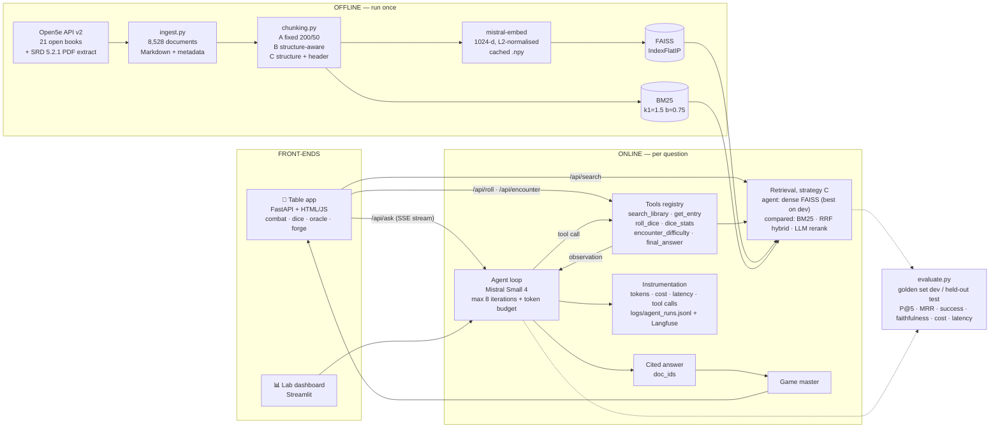

# DM Copilot — architecture data-flow

## Failure handling (Session 6)

| Failure mode | Mitigation in the code | Signal measured |
|---|---|---|
| Non-terminating loop | `final_answer` tool + `MAX_ITERATIONS = 8` + `TOKEN_BUDGET` (`src/agent.py`) | iterations, `terminated_by` |
| Hallucinated tool call | `validate_args` against the JSON schema, unknown tools rejected with the list of real tools (`src/tools.py`) | `hallucinated_calls` / tool calls |
| Error cascade | every tool error returned to the model as an `Error: ...` observation; LLM calls retried with exponential backoff (`src/llm.py`) | `tool_errors` |
| Indirect prompt injection | retrieved text wrapped in `<document>` tags flagged as untrusted data; system prompt forbids following it; 🧪 Poison toggle in the UI to demo it | manual demo |
| Out-of-library question | system prompt + golden-set traps (Beholder, Mind Flayer…) | trap refusal rate |
